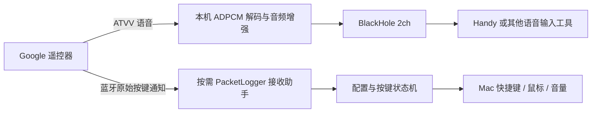

# Google Remote Voice for Mac

**把谷歌遥控器变成 Mac 的按住说话麦克风与快捷键控制器。**

[](https://github.com/zolo1978/google-remote-voice-mac/actions/workflows/ci.yml)
[](LICENSE)
[](#兼容性)

一只已有的 Chromecast Voice Remote，就可以成为轻量、低成本的语音输入硬件：拿起、按住语音键、说话，再把音频交给你选择的输入法。本项目负责连接、麦克风音频与按键映射，**不内置语音识别模型**。

基于 [81199000/mi-remote-mapper](https://github.com/81199000/mi-remote-mapper) 扩展，专注 **Google Chromecast Voice Remote（G9N9N）**。保留上游历史与 MIT 版权，新增 Google ATVV 适配、单字节按键接收、全键配置和按需日志恢复。

> 当前为 0.1 开源实验版。按键接收依赖 Apple 的蓝牙诊断工具及未承诺稳定的 HCI 调试接口，需要管理员授权；已在一台 macOS 15.8.2 / Apple Silicon 机器实测，不能代表所有系统、固件及兼容款。

## 为什么把它作为语音输入硬件

如果你已经有一只 Google 遥控器，它有几个实用优势：

- **有实体语音键**：按住说话，与键盘录制的快捷键一起使用。
- **无线、单手可操作**：适合坐着、站着或离开键盘时发起语音输入。
- **不用另做硬件桥接**：本项目的实测方案直接使用 Mac 蓝牙。
- **不止一颗按钮**：14 个普通实体键可配置方向、确认、音量、快捷键、鼠标或滚轮。
- **音频路径可控**：解码在本机进行；是否完全离线取决于你选择的语音输入工具。

Google 官方规格列有蓝牙、内置语音麦克风及两节 AAA 电池供电，见[遥控器规格](https://support.google.com/chromecast/answer/3046409?hl=en)。这里没有录音室音质、续航或跨设备价格基准，不宣称它在所有场景都胜过专业麦克风。

**优先利用手里的设备。** 新购买前应核对型号及退换条件：只叫“Chromecast Remote”、能配对，或商品写着“兼容 G9N9N”，均不等于语音与全部按键已兼容。本项目不认证第三方商家或批次。

## 能做什么

| 能力 | 当前状态 |
| --- | --- |
| 遥控器麦克风 → BlackHole | ATVV / 16 kHz 单声道 ADPCM，实机已确认人声 |
| 普通实体键 | 实测收到 14/14 的按下与释放 |
| 语音键 | 独立 ATVV 按下/松开，可同时触发快捷键与麦克风 |
| 自定义动作 | Mac 键盘组合、鼠标移动/点击/拖拽、滚轮、系统音量/静音 |
| 防重复触发 | 接收期间独占目标遥控器原生 HID，停止后释放 |
| 清理与恢复 | 停止、退出、父进程结束时释放按键并恢复日志设置 |
| 语音转文字 | 由外部输入法负责；具体工具和版本需实际验证 |

不包含 Windows/Linux 版本；不支持 Apple Siri Remote；Google TV Streamer 的 GY3LE 遥控器尚未验证。

## 原理



本机样机单键报告只有 1 字节，而 HID 描述符声明两个槽位。常规 IOHID 回调只看到长度完整的双键，单键/松开不可见。我们在本机诊断入口读取实收通知，而不是猜测补零或伪造按键。详见[协议与实测记录](docs/PROTOCOL.md)。

## 兼容性

- 当前构建：**Apple Silicon，macOS 14+**；实测系统为 macOS 15.8.2。
- 实测遥控器：Chromecast Voice Remote / G9N9N 家族；VID/PID `18D1:9450`，DIS A0，固件 26.7。
- 同时只启用一支目标遥控器；遇到同款设备歧义会暂停映射。
- 需要 Xcode Command Line Tools、BlackHole 2ch，以及 Apple PacketLogger。
- PacketLogger 必须从 [Apple 官方 Additional Tools for Xcode](https://developer.apple.com/bluetooth/) 获取，可能需要登录 Apple 账号。**仓库不打包 Apple 工具。**
- 本次使用的 PacketLogger App 最低系统要求为 macOS 14，CLI 自报 26.0；其他版本需复验。

## 安装

```sh
git clone https://github.com/zolo1978/google-remote-voice-mac.git
cd google-remote-voice-mac
./install.sh
```

安装脚本会检查 Homebrew、BlackHole 与编译工具，构建并复制 `Google Remote Voice.app` 到“应用程序”。如果首次安装 BlackHole 后无法看到设备，按驱动说明重启。

另行从 Apple 下载 PacketLogger，将 **PacketLogger.app** 放入 `/Applications`，或在本应用中点击“选择工具…”。只下载磁盘镜像但不保留工具位置，会影响下次启动。

首次打开：

1. 在 Mac 系统蓝牙设置中配对并连接遥控器。
2. 打开 **Google Remote Voice**，授予蓝牙、辅助功能、输入监控权限。
3. 打开“按键检测模式”，点击“开启按键接收”，完成系统管理员授权。
4. 每个实体键各按一次，核对已收到计数。检测模式下普通键不执行映射；语音仍独立工作。
5. 关闭检测模式，开始使用映射。

**停止或退出应用会恢复日志设置。** 不需要长期安装蓝牙日志描述文件。请先退出其他正在采集同一遥控器的应用。

## 接入本地语音输入

可搭配 [Handy](https://github.com/cjpais/Handy) 等支持虚拟麦克风与自定义触发键的工具。Handy 提供离线语音识别；本项目不捆绑它，也不保证所有版本均已端到端验收。

配置示例：

1. 在输入工具里选择支持中文的本地模型。
2. 输入设备设为 **BlackHole 2ch**。
3. 选择“按住录音”行为并设一个不冲突的快捷键，例如 `⌥D`。
4. 在本应用的“语音键”行点击“录制”，**在 Mac 键盘上按同一快捷键**，保留“同时开启麦克风”。
5. 在空白文本框中验证按住、说话、松开与文字交付。若输入工具使用点按切换模式，需按其触发语义另行配置。

本项目只有音频桥接和按键功能。文字是否准确、是否发送云端、如何插入光标，由你选用的输入工具决定。

## 默认按键

| 遥控器 | 默认 Mac 动作 |
| --- | --- |
| 上 / 下 / 左 / 右 | 方向键 |
| 确认 | Return |
| 返回 | Backspace（⌫，Mac 显示 Delete） |
| 主页 | Home |
| 音量 +/- | 系统音量 +/- |
| 静音 | 系统静音 |
| 信源 | Tab |
| YouTube / Netflix | F9 / F10，可重新录制 |
| 电源 | F12，可重新录制；默认不让 Mac 睡眠 |
| 语音 | 默认右 Command，可改为输入法的触发快捷键 |

YouTube / Netflix 两行还可在“动作”菜单选择“打开应用…”或“打开网址…”，也有对应网站的预设。设置自动保存，点击“测试”可验证；打开动作只在按下时执行一次，不因长按重复打开。

“录制”用于设置 **目标 Mac 快捷键**，不是重新学习遥控器。浏览器“上一页”通常应另设 `⌘[`；Backspace 表示删除字符，浏览器是否把它当作后退由浏览器设置决定。

协议另有三个扩展索引，放在折叠区，不冒充这支遥控器上的实体键。

## 开发与检查

```sh
sh scripts/run-tests.sh
./build.sh
```

无特权检查目前包含 60 项 Swift 解析/状态/恢复策略检查、33 项配置检查及 8 项 Python 回归。管理员助手的启动/恢复实测需要 Apple 工具和知情授权，不在 CI 自动执行。

本地长期使用建议固定签名身份，避免每次临时签名变化导致权限失效：

```sh
security find-identity -v -p codesigning
GOOGLE_REMOTE_SIGNING_IDENTITY="你的签名身份" ./build.sh
```

也可把身份写入被 git 忽略的 `.local-signing-identity`。不设置时使用临时签名。该开源构建未经 Apple 公证；不要为运行本项目全局关闭 Gatekeeper 或 SIP。

- 配置：`~/Library/Application Support/GoogleRemoteVoice/config.json`
- 应用日志：`~/Library/Logs/GoogleRemoteVoice/engine.log`
- [排障指南](docs/TROUBLESHOOTING.md)
- [安全与日志范围](SECURITY.md)
- [第三方与来源](THIRD_PARTY_NOTICES.md)
- [变更记录](CHANGELOG.md)

## 致谢与许可

本项目扩展自 **零度汉化的 [mi-remote-mapper](https://github.com/81199000/mi-remote-mapper)**，沿用其 Swift 菜单栏应用、音频输出、映射和设置基础，保留原始提交历史及版权。Google 协议与抓包研究参考见[第三方说明](THIRD_PARTY_NOTICES.md)。

本项目代码采用 [MIT](LICENSE)。BlackHole、Apple PacketLogger 和外部输入工具分别遵守各自许可证，不因本仓库采用 MIT 而改变。Google、Chromecast 等名称属于相应权利人；本项目是独立社区项目，与 Google、Apple 无隶属关系。

---

**English:** Turn a Google Chromecast Voice Remote into a push-to-talk microphone and configurable shortcut controller on macOS. Based on mi-remote-mapper, with Google ATVV support, on-demand raw button capture and automatic trace-setting restoration. Apple Silicon/macOS 14+; tested on one macOS 15.8.2 system. Requires BlackHole and separately downloaded Apple PacketLogger. Speech recognition is provided by your chosen external app, not bundled here.
