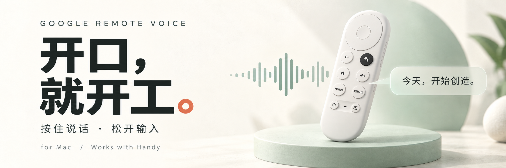
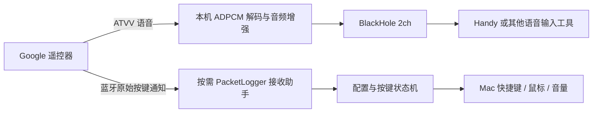

<p align="center">
  
  <br><sub>Google Remote Voice for Mac · 社区开源项目 · 封面为概念插画</sub>
</p>

<p align="center">
  <strong>一只谷歌遥控器，一套开源的 Mac 语音输入方案。</strong><br>
  拿起遥控器，说出想法，让 Handy 把它变成光标下的文字。
</p>

<p align="center">
  <a href="https://github.com/zolo1978/google-remote-voice-mac/actions/workflows/ci.yml"></a>
  
  
  <a href="LICENSE"></a>
</p>

<p align="center">
  <a href="#快速开始"></a>
  &nbsp;
  <a href="https://handy.computer/"></a>
</p>

<p align="center">
  <a href="docs/HANDY.md">Handy 配置</a> &nbsp; / &nbsp;
  <a href="#默认按键">按键玩法</a> &nbsp; / &nbsp;
  <a href="#兼容性">支持设备</a> &nbsp; / &nbsp;
  <a href="docs/TROUBLESHOOTING.md">遇到问题</a> &nbsp; / &nbsp;
  <a href="https://github.com/zolo1978/google-remote-voice-mac/issues">反馈建议</a>
</p>

<br>

<table>
<tr>
<td width="33%" valign="top">
<h3>01 &nbsp; 按住，说话</h3>
实体语音键，一只手就能操作。想法来了，不必先回到键盘前。
</td>
<td width="33%" valign="top">
<h3>02 &nbsp; 松开，出字</h3>
音频经 BlackHole 送入 Handy，由本地模型转写到当前文本框。
</td>
<td width="33%" valign="top">
<h3>03 &nbsp; 每颗键，都有用</h3>
14 个普通实体键可映射快捷键。YouTube、Netflix 也能改为打开应用或网址。
</td>
</tr>
</table>

<br>

> **开始前**：当前为 0.1 实验版，支持已验证的 Chromecast Voice Remote（G9N9N 家族）与 Apple Silicon Mac。普通按键接收需要单独安装 Apple PacketLogger 并完成管理员授权；[先看兼容性](#兼容性)。

## 一套配齐：遥控器 + BlackHole + Handy

| 组件 | 在这套方案里负责什么 | 获取入口 |
| --- | --- | --- |
| **Chromecast Voice Remote** | 实体语音键、麦克风与自定义按键 | 优先使用已有设备；[核对兼容性](#兼容性) |
| **Google Remote Voice** | 连接遥控器、解码音频、映射按键 | [下方安装步骤](#快速开始) |
| **BlackHole 2ch** | 把遥控器音频送进语音识别工具 | [开源项目与安装说明](https://github.com/ExistentialAudio/BlackHole) |
| **Handy** | 在本机把语音转成文字，粘贴到当前文本框 | **[官网下载](https://handy.computer/) · [GitHub](https://github.com/cjpais/Handy) · [发行版本](https://github.com/cjpais/Handy/releases/latest)** |
| **Apple PacketLogger** | 接收常规 HID 未转交的普通按键通知 | [Apple 官方下载页](https://developer.apple.com/download/all/?q=Additional%20Tools)（需 Apple 账号） |

> **第一次用？** 先按[快速开始](#快速开始)装好本项目，再照着 [Handy 配置指南](docs/HANDY.md)设置 **BlackHole 2ch + 按住说话 + 相同快捷键**。

Handy 是独立的免费开源语音转文字工具，支持本地离线识别；本项目不捆绑它。不同软件版本的界面可能有变化，下载入口始终指向其官方站点与仓库。


## 快速开始

```sh
git clone https://github.com/zolo1978/google-remote-voice-mac.git
cd google-remote-voice-mac
./install.sh
```

安装脚本会检查 Homebrew、BlackHole 与编译工具，构建并复制 `Google Remote Voice.app` 到“应用程序”。如果首次安装 BlackHole 后无法看到设备，按驱动说明重启。

另行从 Apple 下载 PacketLogger，将 **PacketLogger.app** 放入 `/Applications`，或在本应用中点击“选择工具…”。只下载磁盘镜像但不保留工具位置，会影响下次启动。

首次打开：

1. 在 Mac 系统蓝牙设置中配对并连接遥控器。
2. 打开 **Google Remote Voice**，授予蓝牙、辅助功能、输入监控权限。
3. 设备和权限就绪后，应用默认自动开启按键接收；在系统窗口完成管理员授权。想逐键核对时，再打开“按键检测模式”。
4. 每个实体键各按一次，核对已收到计数。检测模式下普通键不执行映射；语音仍独立工作。
5. 关闭检测模式，开始使用映射。

**接收会话没有固定运行时长限制；停止或退出应用会恢复日志设置。** “应用启动后自动开启按键接收”默认启用；取消授权或手动停止后，本次运行不会循环弹窗或强行重开。可在设置中关闭自动开启。 不需要长期安装蓝牙日志描述文件。请先退出其他正在采集同一遥控器的应用。


## 配套 Handy：按住说话，松开出字

**[下载 Handy](https://handy.computer/) · [查看 Handy 源码](https://github.com/cjpais/Handy) · [完整配置指南](docs/HANDY.md)**

| 设置位置 | 建议配置 |
| --- | --- |
| Handy → 输入设备 | **BlackHole 2ch**，不要依赖系统默认麦克风 |
| Handy → 录音方式 | **Push to Talk / 按住说话** |
| Handy → 快捷键 | 与本应用语音键完全一致，例如**右 Command** |
| 本应用 → 语音键 | 保留“同时开启麦克风” |
| Handy → 识别模型 | 选择支持中文的本地模型，首次使用先完成模型下载 |

将光标放进文本框，按住遥控器语音键说一句话，松开后等待 Handy 转写。需要自定义触发键时，在本应用点“录制”，再在 **Mac 键盘**上按目标组合键，并在 Handy 中设置同一个组合键。

文字准确度、是否使用云端后处理以及如何交付文字，由输入工具及其配置决定。重复出字时，先检查是否同时启用了 macOS“语音控制”或另一款使用相同热键的听写软件，详见[配套指南](docs/HANDY.md#常见问题)。


## 默认按键

| 遥控器 | 默认 Mac 动作 |
| --- | --- |
| 上 / 下 / 左 / 右 | 方向键 |
| 确认 | Return |
| 返回 | Backspace（⌫，Mac 显示 Delete） |
| 主页 | Home |
| 音量 +/- | 系统音量 +/- |
| 静音 | 系统静音 |
| 信源 | Tab |
| YouTube / Netflix | F9 / F10，可重新录制 |
| 电源 | F12，可重新录制；默认不让 Mac 睡眠 |
| 语音 | 默认右 Command，可改为输入法的触发快捷键 |

YouTube / Netflix 两行还可在“动作”菜单选择“打开应用…”或“打开网址…”，也有对应网站的预设。设置自动保存，点击“测试”可验证；打开动作只在按下时执行一次，不因长按重复打开。

“录制”用于设置 **目标 Mac 快捷键**，不是重新学习遥控器。浏览器“上一页”通常应另设 `⌘[`；Backspace 表示删除字符，浏览器是否把它当作后退由浏览器设置决定。

协议另有三个扩展索引，放在折叠区，不冒充这支遥控器上的实体键。


## 兼容性

- 当前构建：**Apple Silicon，macOS 14+**；实测系统为 macOS 15.8.2。
- 实测遥控器：Chromecast Voice Remote / G9N9N 家族；VID/PID `18D1:9450`，DIS A0，固件 26.7。
- 同时只启用一支目标遥控器；遇到同款设备歧义会暂停映射。
- 需要 Xcode Command Line Tools、BlackHole 2ch，以及 Apple PacketLogger。
- PacketLogger 必须从 [Apple 官方 Additional Tools for Xcode](https://developer.apple.com/bluetooth/) 获取，可能需要登录 Apple 账号。**仓库不打包 Apple 工具。**
- 本次使用的 PacketLogger App 最低系统要求为 macOS 14，CLI 自报 26.0；其他版本需复验。


## 进一步了解

<details>
<summary><strong>为什么是 Google 遥控器？</strong></summary>


如果你已经有一只 Google 遥控器，它有几个实用优势：

- **有实体语音键**：按住说话，与键盘录制的快捷键一起使用。
- **无线、单手可操作**：适合坐着、站着或离开键盘时发起语音输入。
- **不用另做硬件桥接**：本项目的实测方案直接使用 Mac 蓝牙。
- **不止一颗按钮**：14 个普通实体键可配置方向、确认、音量、快捷键、鼠标或滚轮。
- **音频路径可控**：解码在本机进行；是否完全离线取决于你选择的语音输入工具。

Google 官方规格列有蓝牙、内置语音麦克风及两节 AAA 电池供电，见[遥控器规格](https://support.google.com/chromecast/answer/3046409?hl=en)。这里没有录音室音质、续航或跨设备价格基准，不宣称它在所有场景都胜过专业麦克风。

**优先利用手里的设备。** 新购买前应核对型号及退换条件：只叫“Chromecast Remote”、能配对，或商品写着“兼容 G9N9N”，均不等于语音与全部按键已兼容。本项目不认证第三方商家或批次。


</details>

<details>
<summary><strong>蓝牙音频与按键是怎样送进 Mac 的？</strong></summary>




本机样机单键报告只有 1 字节，而 HID 描述符声明两个槽位。常规 IOHID 回调只看到长度完整的双键，单键/松开不可见。我们在本机诊断入口读取实收通知，而不是猜测补零或伪造按键。详见[协议与实测记录](docs/PROTOCOL.md)。


</details>

## 语音与实测记录

<details>
<summary><strong>音质、连接速率与麦克风音量</strong> — 展开查看原理与样机数据</summary>

已测试样机默认连接时，160 字节语音通知仅约 32 包/秒，无法连续供给 16 kHz / 4-bit ADPCM 所需的约 50 包/秒。应用对选中的 Google 遥控器请求低延迟后，本地对照收到 **573 包，首末包跨度 11.459 秒（按 572 个间隔计算约 49.92 包/秒）**，解码时长 11.460 秒；仅为本次样机与系统的结果。

连接请求使用 macOS 未公开的 central-side `setDesiredConnectionLatency:forPeripheral:`。调用前检查方法存在及 arm64 ABI；系统不支持时显示日志警告，不能保证音频质量。“已请求”只表示请求已发出，实际效果仍需用包速率确认。应用退出时尽力请求均衡连接优先级；这不代表已读回并还原原始连接参数。此操作不改系统持久设置、不重置全机蓝牙。保持低延迟可能增加遥控器耗电，不使用时可退出应用。macOS 更新后应重新核对接收速率。

音频处理使用 80 Hz 高通、可调固定增益（推荐 18 dB，约 8 倍；范围 0–24 dB）和只衰减的峰值限幅，已取消旧版最高 24 倍自动增益、噪声门及人声提升 EQ。它不能恢复缺失语音，也不保证消除识别器重复字或误识别。松开语音键后，可在日志查看实际包速率；正常长语音应接近 50 包/秒。

在“语音键”设置中拖动 **麦克风音量** 滑杆即可调节并自动保存；“推荐音量”恢复 18 dB。新版推荐值比初次修复的 12 dB 提高约 6 dB。放大会同时放大声音和环境噪声，靠近麦克风通常比盲目拉到最大更有效。

</details>

<details>
<summary><strong>连续长按输入</strong> — 展开查看保活机制与时长边界</summary>

保持按住语音键即可持续输入，松开后由 Handy 一次转写；Handy 保持“按住说话”，输入选择 BlackHole 2ch。应用按当前 ATVV v1.0 会话 ID 每5秒发送 MIC_EXTEND，松开、断线、退出停止保活。普通键的8秒缺失松开保护不作用于语音。

停顿不等于停止：只要遥控器仍发送音频数据，安静时也保持录音；连续3秒收不到任何音频数据时，会结束本次输入并提示重新按住，避免空录或丢失松开事件后持续采集。本机一次持续长按实测：95.07 秒收到 4726 包（约49.7包/秒），发送19次保活，Handy只生成一条结果。结束时出现蓝牙断开，用户确认这一时长已满足当前用途；这不是保证95秒的固定上限，也没有通过3分钟或无限时长验收。

</details>


## 开发与检查

```sh
sh scripts/run-tests.sh
./build.sh
```

无特权检查目前包含 66 项 Swift 解析/状态/恢复策略检查、42 项配置检查、8 项音频/接口边界检查、83 项语音会话检查、8 项自动启动检查及 8 项 Python 回归。管理员助手的启动/恢复实测需要 Apple 工具和知情授权，不在 CI 自动执行。

本地长期使用建议固定签名身份，避免每次临时签名变化导致权限失效：

```sh
security find-identity -v -p codesigning
GOOGLE_REMOTE_SIGNING_IDENTITY="你的签名身份" ./build.sh
```

也可把身份写入被 git 忽略的 `.local-signing-identity`。不设置时使用临时签名。该开源构建未经 Apple 公证；不要为运行本项目全局关闭 Gatekeeper 或 SIP。

- 配置：`~/Library/Application Support/GoogleRemoteVoice/config.json`
- 应用日志：`~/Library/Logs/GoogleRemoteVoice/engine.log`
- [排障指南](docs/TROUBLESHOOTING.md)
- [安全与日志范围](SECURITY.md)
- [第三方与来源](THIRD_PARTY_NOTICES.md)
- [变更记录](CHANGELOG.md)


## 致谢与许可

本项目扩展自 **零度汉化的 [mi-remote-mapper](https://github.com/81199000/mi-remote-mapper)**，沿用其 Swift 菜单栏应用、音频输出、映射和设置基础，保留原始提交历史及版权。Google 协议与抓包研究参考见[第三方说明](THIRD_PARTY_NOTICES.md)。

本项目代码采用 [MIT](LICENSE)。BlackHole、Apple PacketLogger 和外部输入工具分别遵守各自许可证，不因本仓库采用 MIT 而改变。Google、Chromecast 等名称属于相应权利人；本项目是独立社区项目，与 Google、Apple 无隶属关系。

---

**English:** Turn a Google Chromecast Voice Remote into a push-to-talk microphone and configurable shortcut controller on macOS. Based on mi-remote-mapper, with Google ATVV support, on-demand raw button capture and automatic trace-setting restoration. Apple Silicon/macOS 14+; tested on one macOS 15.8.2 system. Requires BlackHole and separately downloaded Apple PacketLogger. Speech recognition is provided by your chosen external app, not bundled here.
